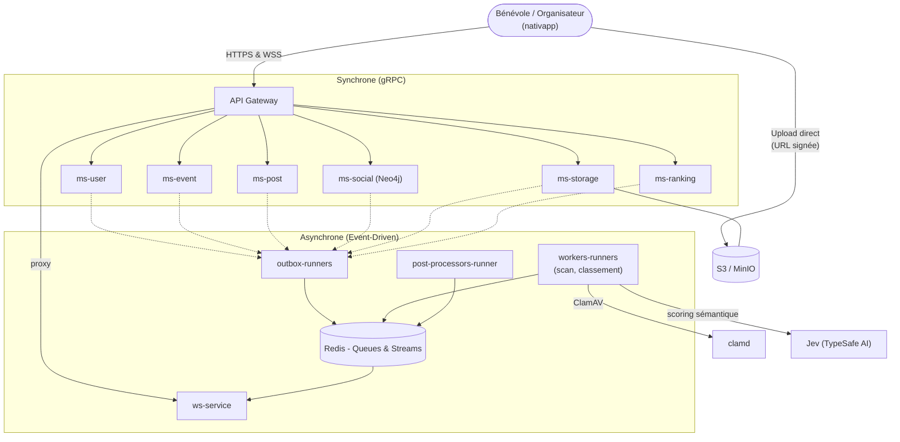

<div align="center">


# Volontariapp

**Connecter les bénévoles aux organisations.**

[LinkedIn - Victor Agahi](https://www.linkedin.com/in/victor-agahi-49b97b292/) · [LinkedIn - Clément Pasteau](https://www.linkedin.com/in/cl%C3%A9ment-pasteau-489615350/) · [LinkedIn - Victor Giroud](https://www.linkedin.com/in/victor-giroud-99096924b/)

[](https://www.typescriptlang.org/)
[](https://nodejs.org/)
[](https://nestjs.com/)
[](https://reactnative.dev/)
[](https://expo.dev/)
[](https://grpc.io/)
[](https://www.postgresql.org/)
[](https://neo4j.com/)
[](https://redis.io/)
[](https://kubernetes.io/)
[](https://argo-cd.readthedocs.io/)
[](https://www.datadoghq.com/)
[](https://www.rust-lang.org/)

</div>

---

## Le Projet

Volontariapp est une plateforme mettant en relation les **bénévoles** et les **organisations** qui proposent des missions et événements. Les utilisateurs découvrent des événements, s'abonnent à des organisations, suivent un fil d'actualités personnalisé et gagnent des badges et un score d'impact ; les organisateurs créent des événements et gèrent les participations.

Le backend est conçu pour qu'**aucune requête utilisateur n'attende jamais un traitement métier lourd** : chaque action (créer un événement, publier un post, envoyer une image) répond en quelques millisecondes, pendant qu'une machinerie asynchrone (Outbox, files BullMQ, Redis Streams) exécute le travail réel en arrière-plan et notifie le client par WebSocket une fois terminé.

## Fonctionnalités

- **Événements et participations** : création, recherche, inscription, liste de souhaits, fin d'événement avec crédit du score d'impact des participants.
- **Fil d'actualités et posts** : posts avec images, commentaires, likes, abonnements.
- **Graphe social** : abonnements, participations et recommandations calculés dans Neo4j.
- **Classement personnalisé (`ms-ranking`)** : un score par utilisateur pour chaque événement et chaque post, calculé en arrière-plan (score structurel, jugement sémantique optionnel par Jev). La lecture est une simple requête indexée ; si rien n'est encore calculé, l'API répond `206 FALLBACK_ACTIVATED` et l'application affiche la liste classique.
- **Stockage de fichiers (`ms-storage`)** : le client envoie les images directement sur S3 par URL signée, dans une quarantaine privée ; un scan antivirus ClamAV et un ré-encodage précèdent la publication. Les services métier ne stockent que des identifiants de fichier.
- **Badges et score d'impact** : 13 badges débloqués automatiquement par des événements métier, avec une modale unique côté client.
- **Suppression de compte en deux temps** : l'événement `user.deleted` est diffusé à chaque domaine (posts, événements, graphe social, fichiers, classement) puis agrégé avant de supprimer définitivement le compte.

## Architecture - Vue d'ensemble

> **Documentation complète (modèle C4)** : [`Volontariapp/docs`](https://github.com/Volontariapp/docs) - [C1 System Context](https://github.com/Volontariapp/docs/blob/main/architecture/C1-System-Context.md) · [C2 Containers](https://github.com/Volontariapp/docs/blob/main/architecture/C2-Containers.md) · [C3 Async Patterns & Flows](https://github.com/Volontariapp/docs/blob/main/architecture/C3-Async-Patterns-And-Flows.md) · [C4 Deployment & Infrastructure](https://github.com/Volontariapp/docs/blob/main/architecture/C4-Deployment-And-Infrastructure.md) · [Structure Monorepo & NPM](https://github.com/Volontariapp/docs/blob/main/architecture/Monorepo-Structure.md)



- **Microservices isolés par domaine** : chaque domaine métier (`ms-user`, `ms-event`, `ms-post`, `ms-social`, `ms-storage`, `ms-ranking`) possède son propre dépôt, son propre processus et sa propre base PostgreSQL, avec son outbox, ses workers et ses post-processors. Aucun état n'est partagé entre domaines ; seul **Redis** sert de bus de messages commun.
- **Transactional Outbox** : chaque écriture métier est enregistrée en même temps qu'un job ou un événement dans la table `jobs_outbox` ou `event_queue`, dans la même transaction SQL atomique, pour garantir qu'aucun message n'est perdu.
- **Scatter-Gather** : une action déclenche plusieurs traitements indépendants en parallèle (géocodage, graphe social, etc.) ; `ws-service` agrège les retours et ne notifie le client en succès que lorsque toutes les étapes ont abouti, avec compensation (rollback de sagas) en cas d'échec partiel.
- **Sécurité par défaut** : aucun microservice n'est exposé sur Internet. L'API Gateway valide le JWT et génère un token interne signé que chaque service gRPC vérifie ; toute requête sans ce token est rejetée.
- **GitOps** : l'intégralité de l'infrastructure Kubernetes (K3s) est pilotée depuis le dépôt [`deploy`](https://github.com/Volontariapp/deploy) via ArgoCD, avec Pod Security Admission restreint, Sealed Secrets et Network Policies en Default-Deny.

## Stack technique

| Couche | Technologies |
| :--- | :--- |
| Application mobile | React Native 0.81, Expo SDK 54, React 19, TanStack Query, React Hook Form, Zod, Socket.io |
| Backend | Node.js 24, NestJS 11, TypeScript, TypeORM, architecture DDD et CQRS |
| Communication | gRPC et Protocol Buffers (contrats centralisés, vérifiés par Buf), WebSocket (Socket.io) |
| Données | PostgreSQL 16 avec PostGIS (une base par service), Neo4j 5 (graphe social), Redis (BullMQ et Streams) |
| Fichiers | S3 (MinIO), URL signées, antivirus ClamAV, ré-encodage d'images |
| IA | Jev (TypeSafe AI) pour le scoring sémantique, activable par drapeau |
| Infrastructure | Kubernetes (K3s), ArgoCD, Kustomize, Traefik, cert-manager, Sealed Secrets |
| Observabilité | OpenTelemetry, Datadog, logger partagé avec masquage des données personnelles |
| CI/CD | GitHub Actions réutilisables ([`ci-tools`](https://github.com/Volontariapp/ci-tools)), Yarn 4, Changesets |

## Intelligence Artificielle et Serveurs MCP

Pour permettre aux agents d'IA (Claude Code, Antigravity, Cursor) de naviguer dans l'ensemble des dépôts sans saturer leur contexte, le projet s'appuie sur le **Model Context Protocol (MCP)**. Deux serveurs jouent des rôles distincts :

- [**`mcp-meta-indexer`**](https://github.com/Volontariapp/mcp-meta-indexer) : serveur MCP écrit en **Rust**, déployé sur le cluster. Un sidecar `git-sync` lui fournit le code, et il expose cinq outils : `smart_search` (recherche plein texte et extraction AST Tree-sitter), `find_dependents` (graphe des imports en mémoire), `analyze_impact` (cartographie causale des flux asynchrones), `analyze_grpc` (cartographie des contrats gRPC) et `search_docs` (recherche dans la documentation).
- **`mesh-mcp`** : outil local d'analyse du workspace, configuré dans [`meta`](https://github.com/Volontariapp/meta) (`.agents/mesh-mcp.toml`). Il indexe l'ensemble des dépôts clonés et expose six outils : `smart_search`, `find_dependents`, `analyze_impact`, `analyze_grpc`, `search_docs` et `visualize_mesh` (vue agrégée de la topologie).

Les agents s'appuient aussi sur des **skills** versionnées dans `meta` (`.agents/skills/volontariapp-*`), tenues à jour par une boucle d'auto-apprentissage : chaque changement de code qu'elles décrivent déclenche leur relecture.

## Écosystème des Dépôts

### Documentation et outils IA
| Dépôt | Rôle |
|---|---|
| [**docs**](https://github.com/Volontariapp/docs) | Documentation d'architecture C4 et dossiers de conception par fonctionnalité (classement, stockage, badges, suppression de compte). |
| [**mcp-meta-indexer**](https://github.com/Volontariapp/mcp-meta-indexer) | Serveur MCP Rust pour l'indexation AST et l'analyse causale de la codebase. |

### Points d'entrée (Gateways et clients)
| Dépôt | Rôle |
|---|---|
| [**nativapp**](https://github.com/Volontariapp/nativapp) | Application mobile React Native (Expo SDK 54). |
| [**api-gateway**](https://github.com/Volontariapp/api-gateway) | Point d'entrée HTTP/REST unique, authentification JWT, token interne, routage gRPC et proxy WebSocket. |
| [**ws-service**](https://github.com/Volontariapp/ws-service) | Microservice WebSocket temps réel (notifications, Scatter-Gather). |

### Microservices métiers (synchrones, gRPC)
| Dépôt | Rôle |
|---|---|
| [**ms-user**](https://github.com/Volontariapp/ms-user) | Identité, authentification, profils, badges, score d'impact et suppression de compte. |
| [**ms-event**](https://github.com/Volontariapp/ms-event) | Missions et événements, cœur de métier. |
| [**ms-post**](https://github.com/Volontariapp/ms-post) | Fil d'actualités, posts et commentaires. |
| [**ms-social**](https://github.com/Volontariapp/ms-social) | Graphe social (Neo4j) : abonnements, participations et recommandations. |
| [**ms-storage**](https://github.com/Volontariapp/ms-storage) | Fichiers : URL signées, quarantaine, métadonnées et rattachement aux entités. |
| [**ms-ranking**](https://github.com/Volontariapp/ms-ranking) | Classement personnalisé des événements et des posts. |

### Infrastructure asynchrone (Event-Driven)
| Dépôt | Rôle |
|---|---|
| [**outbox-runners**](https://github.com/Volontariapp/outbox-runners) | Daemons d'extraction transactionnelle PostgreSQL vers Redis, un par domaine. |
| [**workers-runners**](https://github.com/Volontariapp/workers-runners) | Traitement des tâches d'arrière-plan (BullMQ) : scan de fichiers, calcul de classement, etc. |
| [**post-processors-runner**](https://github.com/Volontariapp/post-processors-runner) | Consommation des Redis Streams : clôture des sagas, badges, rattachement de fichiers, purge de compte. |

### Outillage et déploiement
| Dépôt | Rôle |
|---|---|
| [**npm-packages**](https://github.com/Volontariapp/npm-packages) | Monorepo des librairies partagées `@volontariapp/*` (domaines, contrats, messagerie, framework interne). |
| [**proto-registry**](https://github.com/Volontariapp/proto-registry) | Registre unique des contrats Protocol Buffers (source de vérité gRPC). |
| [**deploy**](https://github.com/Volontariapp/deploy) | Source de vérité GitOps (Kubernetes, K3s, ArgoCD, sécurité de l'infrastructure). |
| [**ci-tools**](https://github.com/Volontariapp/ci-tools) | Workflows et actions GitHub Actions partagés, infrastructure locale docker-compose. |
| [**changelog-checker**](https://github.com/Volontariapp/changelog-checker) | Validation automatisée des versions et des changelogs. |
| [**meta**](https://github.com/Volontariapp/meta) | Méta-dépôt d'orchestration : onboarding, environnement local unifié, skills et règles des agents. |

## Pour commencer

Le point d'entrée pour cloner et lancer l'écosystème complet en local se trouve dans le dépôt [**meta**](https://github.com/Volontariapp/meta) :

```bash
git clone git@github.com:Volontariapp/meta.git
cd meta
bash root.sh   # Full Setup - clone, configure et installe tous les sous-dépôts
```

---

<div align="center">

© EPITA - Projet pédagogique. Tous droits réservés.

</div>
