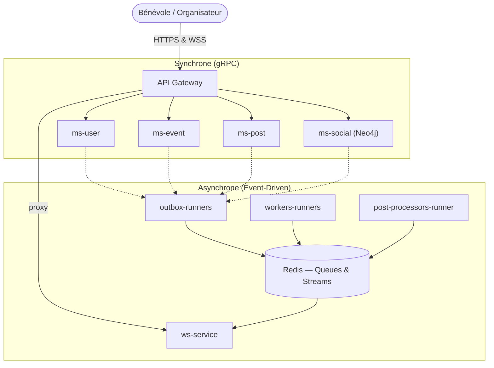

<div align="center">


# Volontariapp

**Connecter les bénévoles aux organisations.**

[LinkedIn — Victor Agahi](https://www.linkedin.com/in/victor-agahi-49b97b292/) · [LinkedIn — Clément Pasteau](https://www.linkedin.com/in/cl%C3%A9ment-pasteau-489615350/) · [LinkedIn — Victor Giroud](https://www.linkedin.com/in/victor-giroud-99096924b/)

[](https://www.typescriptlang.org/)
[](https://nestjs.com/)
[](https://reactnative.dev/)
[](https://www.postgresql.org/)
[](https://redis.io/)
[](https://neo4j.com/)
[](https://kubernetes.io/)
[](https://argo-cd.readthedocs.io/)

</div>

---

## Le Projet

Volontariapp est une plateforme mettant en relation les **bénévoles** et les **organisations** qui proposent des missions et événements. Les utilisateurs découvrent des missions, s'abonnent à des organisations et suivent un fil d'actualités ; les organisateurs créent des événements et gèrent les participations.

Le backend est conçu pour qu'**aucune requête utilisateur n'attende jamais un traitement métier lourd** : chaque action (créer un événement, publier un post, s'abonner) répond en quelques millisecondes, pendant qu'une machinerie asynchrone (Outbox, files BullMQ, Redis Streams) exécute le travail réel en arrière-plan et notifie le client par WebSocket une fois terminé.

## Architecture — Vue d'ensemble

> Documentation complète (modèle **C4**) : [`meta/docs`](https://github.com/Volontariapp/meta/tree/main/docs) — [C1 System Context](https://github.com/Volontariapp/meta/blob/main/docs/C1-System-Context.md) · [C2 Containers](https://github.com/Volontariapp/meta/blob/main/docs/C2-Containers.md) · [C3 Async Patterns & Flows](https://github.com/Volontariapp/meta/blob/main/docs/C3-Async-Patterns-And-Flows.md) · [C4 Deployment & Infrastructure](https://github.com/Volontariapp/meta/blob/main/docs/C4-Deployment-And-Infrastructure.md) · [Structure Monorepo](https://github.com/Volontariapp/meta/blob/main/docs/Monorepo-Structure.md)



- **Microservices isolés par domaine** : chaque domaine métier (`ms-user`, `ms-event`, `ms-post`, `ms-social`) possède son propre dépôt, son propre processus et sa propre base de données. Aucun état n'est partagé entre domaines — seul **Redis** sert de bus de messages commun.
- **Transactional Outbox** : chaque écriture métier est enregistrée en même temps qu'un "ticket" d'événement, dans la même transaction SQL, pour garantir qu'aucun message n'est jamais perdu.
- **Scatter-Gather** : une action déclenche plusieurs traitements indépendants en parallèle (géocodage, graphe social, etc.) ; le client n'est notifié en succès que lorsque toutes les étapes ont abouti — avec compensation automatique (rollback) en cas d'échec partiel.
- **GitOps** : l'intégralité de l'infrastructure Kubernetes (K3s) est pilotée depuis le dépôt [`deploy`](https://github.com/Volontariapp/deploy) via ArgoCD — Pod Security Admissions, Sealed Secrets, Network Policies en Default-Deny.

## Écosystème des Dépôts

### Points d'entrée (Gateways & Clients)
| Dépôt | Rôle |
|---|---|
| [**nativapp**](https://github.com/Volontariapp/nativapp) | Application mobile React Native (iOS / Android). |
| [**api-gateway**](https://github.com/Volontariapp/api-gateway) | Point d'entrée HTTP/gRPC unique, authentification et routage. |
| [**ws-service**](https://github.com/Volontariapp/ws-service) | Microservice WebSocket (notifications temps réel, Scatter-Gather). |

### Microservices métiers (synchrones, gRPC)
| Dépôt | Rôle |
|---|---|
| [**ms-user**](https://github.com/Volontariapp/ms-user) | Identité et profil utilisateur. |
| [**ms-event**](https://github.com/Volontariapp/ms-event) | Missions et événements — cœur de métier. |
| [**ms-post**](https://github.com/Volontariapp/ms-post) | Fil d'actualités et contenu. |
| [**ms-social**](https://github.com/Volontariapp/ms-social) | Graphe social (Neo4j) — abonnements et recommandations. |

### Infrastructure asynchrone (Event-Driven)
| Dépôt | Rôle |
|---|---|
| [**outbox-runners**](https://github.com/Volontariapp/outbox-runners) | Extraction transactionnelle PostgreSQL → Redis. |
| [**workers-runners**](https://github.com/Volontariapp/workers-runners) | Traitement des tâches d'arrière-plan (BullMQ). |
| [**post-processors-runner**](https://github.com/Volontariapp/post-processors-runner) | Consommation des Redis Streams, clôture des Sagas. |

### Outillage & Déploiement
| Dépôt | Rôle |
|---|---|
| [**npm-packages**](https://github.com/Volontariapp/npm-packages) | Monorepo des librairies partagées `@volontariapp/*` (domaines, contrats). |
| [**proto-registry**](https://github.com/Volontariapp/proto-registry) | Registre unique des contrats Protocol Buffers (SSOT gRPC). |
| [**deploy**](https://github.com/Volontariapp/deploy) | Source de vérité GitOps (Kubernetes, ArgoCD, sécurité infra). |
| [**meta**](https://github.com/Volontariapp/meta) | Méta-dépôt d'orchestration — scripts d'onboarding, documentation d'architecture. |

## Pour commencer

Le point d'entrée pour cloner et lancer l'écosystème complet en local se trouve dans le dépôt [**meta**](https://github.com/Volontariapp/meta) :

```bash
git clone git@github.com:Volontariapp/meta.git
cd meta
bash root.sh   # Full Setup — clone, configure et installe tous les sous-dépôts
```

---

<div align="center">

© EPITA — Projet pédagogique. Tous droits réservés.

</div>
